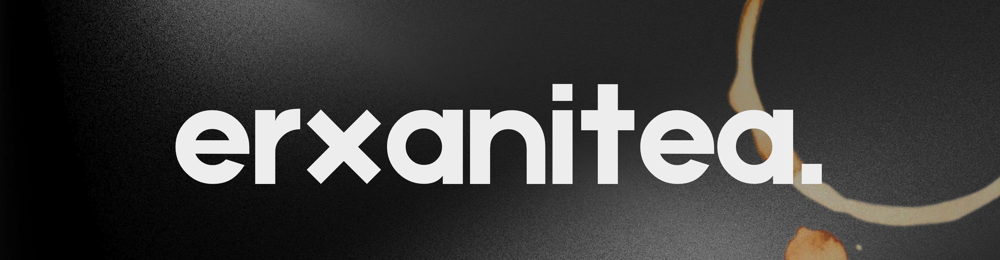
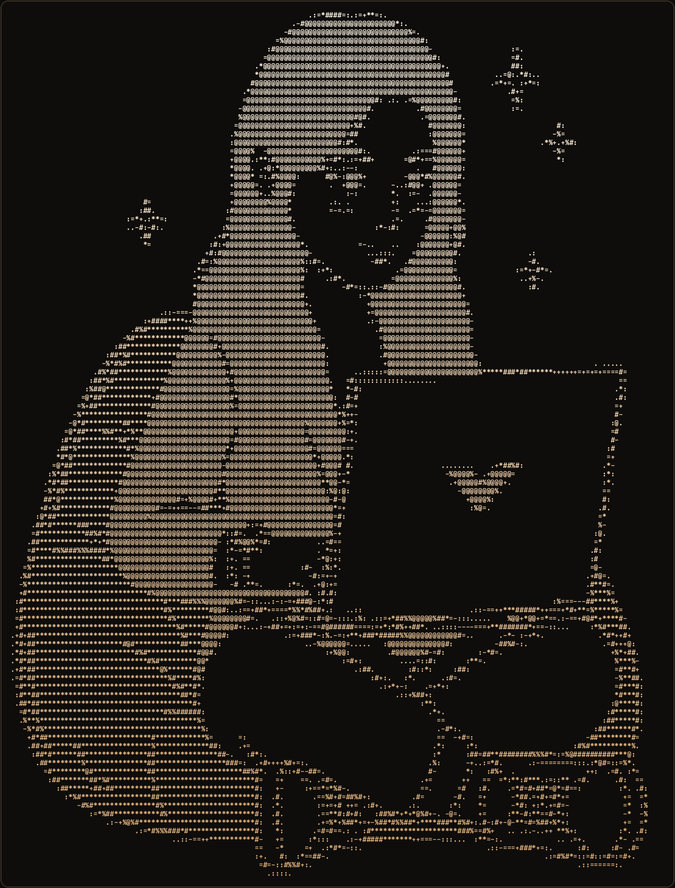
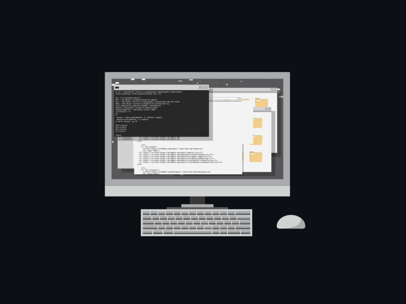

  

<h1 align="center">Hi, I'm Era 🍵</h1>

  

  

  Front-end developer for web and mobile, junior business analytics, and AI engineering. 
  I build clean interfaces, keep development organized, and turn product goals into dependable code.

  &nbsp;
  &nbsp;
  &nbsp;
  &nbsp;
  

  

<table border="0" width="100%">
  <tr>
    <td width="58%" valign="top">
      <h3>🧭 About Me</h3>
      

        I am a <b>front-end developer for web and mobile</b> with a working background in <b>junior business analytics</b> and <b>AI engineering</b>. I focus on building responsive, intuitive user interfaces, backed by a solid understanding of full-stack workflows and Agile project management to make sure every build serves a clear purpose.
      

      

        As a project lead, I run <b>Agile and Scrum</b> workflows with <b>Jira</b> and <b>Trello</b> to organize tasks, support the team, and keep releases on schedule. I care about writing straightforward code, building smooth user experiences, and exploring practical AI integrations.
      

      <ul>
        <li>💻 <b>Primary Focus:</b> Front-End Development (Web &amp; Mobile)</li>
        <li>📊 <b>Analytics &amp; AI:</b> Junior Business Analytics · AI Engineering</li>
        <li>📋 <b>Project Management:</b> Project Lead · Agile &amp; Scrum Sprints (Jira, Trello)</li>
        <li>☁️ <b>Community:</b> Marketing Volunteer @ <b>AWS User Group Davao</b></li>
        <li>🦉 <b>Academic:</b> Former Communications @ <b>Data Owls (University of Mindanao)</b></li>
        <li>🏃 <b>Hobbies:</b> Distance running · Reading · Film</li>
        <li>🍵 <b>Philosophy:</b> Build things that are simple, reliable, and intuitive</li>
      </ul>
      <blockquote>
        <i>"Devote yourself to loving others, devote yourself to your community around you, and devote yourself to creating something that gives you purpose and meaning."</i>
         
        Mitch Albom, <i>Tuesdays with Morrie</i>
      </blockquote>
    </td>
    <td width="42%" align="center" valign="middle">
      
    </td>
  </tr>
</table>

 

<table border="0" width="100%">
  <tr>
    <td width="42%" align="center" valign="middle">
      
    </td>
    <td width="58%" valign="top">
      <h3>⚡ Workstation &amp; Development Flow</h3>
      

        A practical workflow combining hands-on development with organized Agile delivery.
      

      <ul>
        <li>💻 <b>Daily Drivers &amp; IDEs:</b> VS Code &amp; Antigravity IDE (Linux &amp; Windows)</li>
        <li>📋 <b>Project Management:</b> Agile and Scrum sprints with Jira, Trello, and GitHub Projects</li>
        <li>🤖 <b>AI &amp; Prototyping:</b> Jupyter, Lovable, local and cloud LLMs</li>
        <li>☁️ <b>Build &amp; Deploy:</b> Cloudflare, Git, Vite</li>
        <li>🍵 <b>Desk Setup:</b> Freshly brewed tea and focused terminal sessions</li>
      </ul>
      <blockquote>
        <i>&ldquo;I like things that are cool and useful.&rdquo;</i>
      </blockquote>
    </td>
  </tr>
</table>

  

<h2 align="center">🧰 Tech Stacks &amp; Languages</h2>

  

<table width="100%">
  <tr>
    <td width="33.3%" valign="top">
      <h4 align="center">💻 Languages</h4>
      

        
        
        
        
        
         
        
        
        
        
        
      

    </td>
    <td width="33.3%" valign="top">
      <h4 align="center">⚙️ Frameworks &amp; UI</h4>
      

        
        
        
         
        
        
         
        
        
      

    </td>
    <td width="33.3%" valign="top">
      <h4 align="center">☁️ Backend, Cloud &amp; DB</h4>
      

        
        
        <img src="https://img.shields.io/badge/AWS-141210?style=flat-square&logo=data%3Aimage/svg%2Bxml%3Bbase64%2CPHN2ZyByb2xlPSJpbWciIHZpZXdCb3g9IjAgMCAyNCAyNCIgeG1sbnM9Imh0dHA6Ly93d3cudzMub3JnLzIwMDAvc3ZnIj48cGF0aCBmaWxsPSIjQzg5NjY2IiBkPSJNNi43NjMgMTAuMDM2YzAgLjI5Ni4wMzIuNTM1LjA4OC43MS4wNjQuMTc2LjE0NC4zNjguMjU2LjU3Ni4wNC4wNjMuMDU2LjEyNy4wNTYuMTgzIDAgLjA4LS4wNDguMTYtLjE1Mi4yNGwtLjUwMy4zMzVhLjM4My4zODMgMCAwIDEtLjIwOC4wNzJjLS4wOCAwLS4xNi0uMDQtLjIzOS0uMTEyYTIuNDcgMi40NyAwIDAgMS0uMjg3LS4zNzUgNi4xOCA2LjE4IDAgMCAxLS4yNDgtLjQ3MWMtLjYyMi43MzQtMS40MDUgMS4xMDEtMi4zNDcgMS4xMDEtLjY3IDAtMS4yMDUtLjE5MS0xLjU5Ni0uNTc0LS4zOTEtLjM4NC0uNTktLjg5NC0uNTktMS41MzMgMC0uNjc4LjIzOS0xLjIzLjcyNi0xLjY0NC40ODctLjQxNSAxLjEzMy0uNjIzIDEuOTU1LS42MjMuMjcyIDAgLjU1MS4wMjQuODQ2LjA2NC4yOTYuMDQuNi4xMDQuOTE4LjE3NnYtLjU4M2MwLS42MDctLjEyNy0xLjAzLS4zNzUtMS4yNzctLjI1NS0uMjQ4LS42ODYtLjM2Ny0xLjMtLjM2Ny0uMjggMC0uNTY4LjAzMS0uODYzLjEwMy0uMjk1LjA3Mi0uNTgzLjE2LS44NjIuMjcyYTIuMjg3IDIuMjg3IDAgMCAxLS4yOC4xMDQuNDg4LjQ4OCAwIDAgMS0uMTI3LjAyM2MtLjExMiAwLS4xNjgtLjA4LS4xNjgtLjI0N3YtLjM5MWMwLS4xMjguMDE2LS4yMjQuMDU2LS4yOGEuNTk3LjU5NyAwIDAgMSAuMjI0LS4xNjdjLjI3OS0uMTQ0LjYxNC0uMjY0IDEuMDA1LS4zNmE0Ljg0IDQuODQgMCAwIDEgMS4yNDYtLjE1MWMuOTUgMCAxLjY0NC4yMTYgMi4wOTEuNjQ3LjQzOS40My42NjIgMS4wODUuNjYyIDEuOTYzdjIuNTg2em0tMy4yNCAxLjIxNGMuMjYzIDAgLjUzNC0uMDQ4LjgyMi0uMTQ0LjI4Ny0uMDk2LjU0My0uMjcxLjc1OC0uNTEuMTI4LS4xNTIuMjI0LS4zMi4yNzItLjUxMi4wNDctLjE5MS4wOC0uNDIzLjA4LS42OTR2LS4zMzVhNi42NiA2LjY2IDAgMCAwLS43MzUtLjEzNiA2LjAyIDYuMDIgMCAwIDAtLjc1LS4wNDhjLS41MzUgMC0uOTI2LjEwNC0xLjE5LjMyLS4yNjMuMjE1LS4zOS41MTgtLjM5LjkxNyAwIC4zNzUuMDk1LjY1NS4yOTUuODQ2LjE5MS4yLjQ3LjI5Ni44MzguMjk2em02LjQxLjg2MmMtLjE0NCAwLS4yNC0uMDI0LS4zMDQtLjA4LS4wNjQtLjA0OC0uMTItLjE2LS4xNjgtLjMxMUw3LjU4NiA1LjU1YTEuMzk4IDEuMzk4IDAgMCAxLS4wNzItLjMyYzAtLjEyOC4wNjQtLjIuMTkxLS4yaC43ODNjLjE1MSAwIC4yNTUuMDI1LjMxLjA4LjA2NS4wNDguMTEzLjE2LjE2LjMxMmwxLjM0MiA1LjI4NCAxLjI0NS01LjI4NGMuMDQtLjE2LjA4OC0uMjY0LjE1MS0uMzEyYS41NDkuNTQ5IDAgMCAxIC4zMi0uMDhoLjYzOGMuMTUyIDAgLjI1Ni4wMjUuMzIuMDguMDYzLjA0OC4xMi4xNi4xNTEuMzEybDEuMjYxIDUuMzQ4IDEuMzgxLTUuMzQ4Yy4wNDgtLjE2LjEwNC0uMjY0LjE2LS4zMTJhLjUyLjUyIDAgMCAxIC4zMTEtLjA4aC43NDNjLjEyNyAwIC4yLjA2NS4yLjIgMCAuMDQtLjAwOS4wOC0uMDE3LjEyOGExLjEzNyAxLjEzNyAwIDAgMS0uMDU2LjJsLTEuOTIzIDYuMTdjLS4wNDguMTYtLjEwNC4yNjMtLjE2OC4zMTFhLjUxLjUxIDAgMCAxLS4zMDMuMDhoLS42ODdjLS4xNTEgMC0uMjU1LS4wMjQtLjMyLS4wOC0uMDYzLS4wNTYtLjExOS0uMTYtLjE1LS4zMmwtMS4yMzgtNS4xNDgtMS4yMyA1LjE0Yy0uMDQuMTYtLjA4Ny4yNjQtLjE1LjMyLS4wNjUuMDU2LS4xNzcuMDgtLjMyLjA4em0xMC4yNTYuMjE1Yy0uNDE1IDAtLjgzLS4wNDgtMS4yMjktLjE0My0uMzk5LS4wOTYtLjcxLS4yLS45MTgtLjMyLS4xMjgtLjA3MS0uMjE1LS4xNTEtLjI0Ny0uMjIzYS41NjMuNTYzIDAgMCAxLS4wNDgtLjIyNHYtLjQwN2MwLS4xNjcuMDY0LS4yNDcuMTgzLS4yNDcuMDQ4IDAgLjA5Ni4wMDguMTQ0LjAyNC4wNDguMDE2LjEyLjA0OC4yLjA4LjI3MS4xMi41NjYuMjE1Ljg3OC4yNzkuMzE5LjA2NC42My4wOTYuOTUuMDk2LjUwMiAwIC44OTQtLjA4OCAxLjE2NS0uMjY0YS44Ni44NiAwIDAgMCAuNDE1LS43NTguNzc3Ljc3NyAwIDAgMC0uMjE1LS41NTljLS4xNDQtLjE1MS0uNDE2LS4yODctLjgwNy0uNDE1bC0xLjE1Ny0uMzZjLS41ODMtLjE4My0xLjAxNC0uNDU0LTEuMjc3LS44MTNhMS45MDIgMS45MDIgMCAwIDEtLjQtMS4xNThjMC0uMzM1LjA3My0uNjMuMjE2LS44ODYuMTQ0LS4yNTUuMzM1LS40NzkuNTc1LS42NTQuMjQtLjE4NC41MS0uMzIuODMtLjQxNS4zMi0uMDk2LjY1NS0uMTM2IDEuMDA2LS4xMzYuMTc1IDAgLjM1OS4wMDguNTM1LjAzMi4xODMuMDI0LjM1LjA1Ni41MTguMDg4LjE2LjA0LjMxMi4wOC40NTUuMTI3LjE0NC4wNDguMjU2LjA5Ni4zMzYuMTQ0YS42OS42OSAwIDAgMSAuMjQuMi40My40MyAwIDAgMSAuMDcxLjI2M3YuMzc1YzAgLjE2OC0uMDY0LjI1Ni0uMTg0LjI1NmEuODMuODMgMCAwIDEtLjMwMy0uMDk2IDMuNjUyIDMuNjUyIDAgMCAwLTEuNTMyLS4zMTFjLS40NTUgMC0uODE1LjA3MS0xLjA2Mi4yMjMtLjI0OC4xNTItLjM3NS4zODMtLjM3NS43MSAwIC4yMjQuMDguNDE2LjI0LjU2Ny4xNTkuMTUyLjQ1NC4zMDQuODc3LjQ0bDEuMTM0LjM1OGMuNTc0LjE4NC45OS40NCAxLjIzNy43NjcuMjQ3LjMyNy4zNjcuNzAyLjM2NyAxLjExNyAwIC4zNDMtLjA3Mi42NTUtLjIwNy45MjYtLjE0NC4yNzItLjMzNi41MTEtLjU4My43MDMtLjI0OC4yLS41NDMuMzQzLS44ODYuNDQ3LS4zNi4xMTEtLjczNC4xNjctMS4xNDIuMTY3ek0yMS42OTggMTYuMjA3Yy0yLjYyNiAxLjk0LTYuNDQyIDIuOTY5LTkuNzIyIDIuOTY5LTQuNTk4IDAtOC43NC0xLjctMTEuODctNC41MjYtLjI0Ny0uMjIzLS4wMjQtLjUyNy4yNzItLjM1MSAzLjM4NCAxLjk2MyA3LjU1OSAzLjE1MyAxMS44NzcgMy4xNTMgMi45MTQgMCA2LjExNC0uNjA3IDkuMDYtMS44NTIuNDM5LS4yLjgxNC4yODcuMzgzLjYwN3pNMjIuNzkyIDE0Ljk2MWMtLjMzNi0uNDMtMi4yMi0uMjA3LTMuMDc0LS4xMDMtLjI1NS4wMzItLjI5NS0uMTkyLS4wNjMtLjM2IDEuNS0xLjA1MyAzLjk2Ny0uNzUgNC4yNTQtLjM5OS4yODcuMzYtLjA4IDIuODI2LTEuNDg1IDQuMDA3LS4yMTUuMTg0LS40MjMuMDg4LS4zMjctLjE1MS4zMi0uNzkgMS4wMy0yLjU3LjY5NS0yLjk5NHoiLz48L3N2Zz4%3D" alt="AWS" />
         
        
        
        
         
        
        
        
      

    </td>
  </tr>
  <tr>
    <td width="33.3%" valign="top">
      <h4 align="center">🤖 AI &amp; Analytics</h4>
      

        
        
         
        
        
         
        
        
        
      

    </td>
    <td width="33.3%" valign="top">
      <h4 align="center">🛠️ IDEs &amp; Dev Tools</h4>
      

        
        
         
        
        
        
         
        
        
         
        
        
        
      

    </td>
    <td width="33.3%" valign="top">
      <h4 align="center">📋 Project Leadership &amp; PM</h4>
      

        
        
         
        
        
         
        
      

    </td>
  </tr>
</table>

  

<h2 align="center">Featured Projects</h2>

<table width="100%">
  <tr>
    <td width="50%" valign="top">
      <h3>Arple</h3>
      
Endpoint network threat defense &amp; intrusion detection system featuring real-time packet sniffing, ARP spoof detection, and one-click firewall isolation.

      

        
        
        
      

    </td>
    <td width="50%" valign="top">
      <h3>MyBingeList</h3>
      
A modern paper journal for cinema watchlists, book nook shelves, and music archives. Hand-crafted with interactive 3D elements and TMDB integration.

      

        
        
        
      

    </td>
  </tr>
  <tr>
    <td width="50%" valign="top">
      <h3>CampusConnect</h3>
      
A unified mobile application built with Flutter &amp; Firebase for enhancing campus engagement by bringing essential services into one platform.

      

        
        
        
      

    </td>
    <td width="50%" valign="top">
      <h3>TravelMind</h3>
      
A machine learning destination predictor powered by Random Forest multi-class classification for intelligent travel recommendations.

      

        
        
        
      

    </td>
  </tr>
</table>

  

<h2 align="center">🏛️ Experience &amp; Education</h2>

<table width="100%">
  <tr>
    <td width="50%" valign="top">
      <h3>☁️ Experience &amp; Community</h3>
      

        <b>AWS User Group Davao</b> 
        <i>Marketing Team (Nov 2025 - Present) · Volunteer</i> 
        Writing community updates, boosting member engagement, and co-hosting developer meetups.
      

      

        <b>Data Owls | University of Mindanao</b> 
        <i>Communications Team (Sep 2024 - Jul 2025) · Student Org</i> 
        Managed media communications and outreach for campus data science sessions.
      

    </td>
    <td width="50%" valign="top" align="center">
      <h3>🎓 Education &amp; Alma Mater</h3>
      

         
        <b>University of Mindanao</b> 
        <b>Bachelor of Science in Information Technology</b> 
        <i>2023 - 2027 · Davao City, Philippines</i>
      

      

        
      

    </td>
  </tr>
</table>

  

<h2 align="center">📊 GitHub Metrics &amp; Streaks</h2>

<table width="100%">
  <tr>
    <td width="50%" align="center" valign="middle">
      
    </td>
    <td width="50%" align="center" valign="middle">
      
    </td>
  </tr>
</table>

  

  

  

